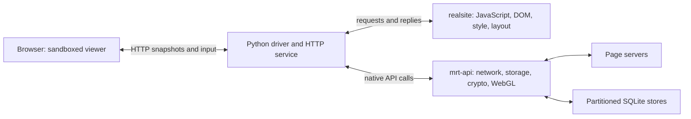

# Architecture

mini-runtime separates a page's execution from the browser that displays it. Its main use here is an interactive standalone page with an HTTP viewer; the same runtime also supports headless measurement and Firefox-backed comparisons.

## Processes and responsibilities

`realsite` embeds SpiderMonkey through a C++ interface. JavaScript DOM objects refer to node ids in the arena DOM. Firefox's HTML parser populates that arena; Stylo computes styles, and translated layout code builds frames and geometry. The runtime does not paint.

`tools/view.py` accepts a URL, locks a native profile, assigns private session output paths and launches the driver. Native profile stores survive service restarts; live document state and sessionStorage do not. `bench/mini_realsites.py` loads the page, launches runtimes and API processes, routes requests, controls navigation and collects reports. `bench/http_viewer.py` serves the viewer and manages its active session. A service selects one top-level runtime; embedded contexts can require additional runtime/API processes.

`mrt-api` handles supported browser APIs without a privileged Firefox tab: HTTP requests, WebSockets, cookies, storage, cryptography, environment answers, image metadata, permissions and native WebGL. Stores are partitioned by site and top-level site. Original page URLs and origins govern API requests; attaching a viewer does not change that origin. The native process supplies a built-in desktop environment, also exported through `mrt-api --default-env` for the driver's initial viewport and network identity. Explicit `API_ENV` selects an optional comparison recording.

The browser adapter rebuilds a sandboxed document from runtime snapshots and incremental changes. Page scripts do not execute there. The browser supplies painting, user input and media playback. Native WebGL runs in the API process; the viewer replays commands to display graphics. The displayed document still has the service's origin, so browser resource behavior is not identical to loading the original site directly.

## Attaching, input and reconnect

A new attachment replaces the previous viewer session. It receives a snapshot of DOM/shadow trees, styles, form state, scroll and history availability, then incremental updates. The viewer acknowledges a synchronized snapshot and viewport before input is accepted. Scroll restoration waits for resource layout to settle.

Input records identify runtime nodes and are processed in order. Accepted events and their handlers run before a replacement viewer takes a snapshot. Editable caret/selection is preserved across compatible mirror updates; bounded native editable snapshots let runtime handlers observe browser edits. This covers tested text-editing flows, not all rich-editor or input-method behavior.

Session ids and backend epochs reject stale input and media replies. A bounded update journal prevents a slow viewer from accumulating unlimited DOM updates; overflow causes a new snapshot. Media and WebGL have separate replay journals because their browser objects cannot be reconstructed from DOM alone.

The service uses HTTP long polling for updates and JSON POSTs for input/lifecycle. It accepts IPv4 loopback connections, validates Host and Origin, and requires a random token. The token authorizes input and stop as well as viewing.

## Document navigation

A runtime's document global and origin are fixed at startup. For another document, the driver fetches the destination, launches a new runtime and switches the viewer after it is ready. It then shuts down the old runtime and its API processes. Same-document history changes keep the current runtime.

The driver preserves session history and per-origin sessionStorage, while native persisted stores carry cookies and supported storage across document changes. Toolbar Back/Forward commands traverse that runtime history through ordered input. Cross-document traversal reloads the URL as GET; there is no back-forward document cache or form-body resubmission.

During a load, input and history controls are disabled. Failed or refused destinations retain the old document and show a notice. New windows and non-HTML destinations do not open ordinary-browser fallbacks. See [viewer operation](viewer.md#navigation-and-history) for limits.

## Hibernation and memory

When the viewer disconnects and its lease expires, the runtime can discard rebuildable frame and style data while retaining DOM and JavaScript state. Attachment wakes it and rebuilds the required layout. Existing timer rules still apply while detached; detachment is not equivalent to terminating the page. Media promises tied to a lost browser backend are rejected, and supported media state is reconstructed when another viewer attaches.

The system still uses a browser to display a page. Memory comparisons must account for the runtime, API processes and viewer browser, rather than assuming the runtime's own memory equals the entire cost. [Measurement tools](measurements.md) explain the comparison paths.

## Other execution modes

`NO_FIREFOX=1` runs finite standalone measurements without an attached viewer. HTTP viewer mode keeps the runtime on its real clock until the service is stopped. Both route all supported services to the native API process.

Firefox bridge mode starts a Marionette-controlled Firefox and forwards selected calls to a privileged browser tab. It is used for reference comparisons and services unavailable natively. Standalone use supplies its own desktop environment by default. An explicit API_ENV recording is optional for comparisons and does not keep a bridge running.
